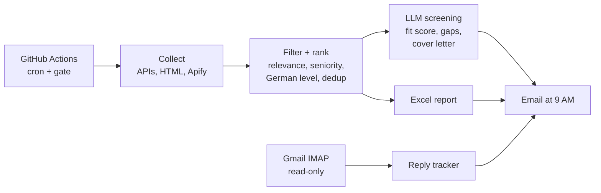

# Internship Radar

[](https://github.com/Bvrmnaidu/internship-radar/actions/workflows/tests.yml)

A daily pipeline that finds data and AI internships in Germany, ranks them against my CV, screens the best ones with an LLM, and emails me a report at 9 AM Hamburg time.

I built it for my own search for a mandatory internship (Pflichtpraktikum) during my M.Sc. in Applied Data Science. It runs every morning on GitHub Actions and costs almost nothing.

**One real run (26 Oct 2026):** 9 sources, 221 relevant listings, 64 of them from LinkedIn, Glassdoor and Indeed, an AI-screened top 5, and a summary of employer replies from my inbox.

## What it does

1. **Collects** internship listings from 9 sources: public APIs, a few HTML pages, and LinkedIn, Glassdoor and Indeed through hosted [Apify](https://apify.com) scrapers.
2. **Filters and ranks** them: data/AI roles only, internships above senior roles, postings that need fluent German ranked down (my German is A2), duplicates across portals merged.
3. **Screens the shortlist with an LLM** against a structured profile (`profile/cv.json`): fit score, the 5 CV points to lead with, gaps, and a draft cover letter for the best matches. Facts may only come from the profile, so the model cannot invent experience.
4. **Checks my inbox** for employer replies from the last 48 hours and labels them: online test or deadline, interview, rejection, received.
5. **Emails** an HTML summary plus a formatted Excel file with every listing.



## How a day runs

GitHub's scheduler is unreliable: it dropped one run and started others about 5 hours late. So the workflow has six cron triggers, and a small gate script ([`.github/scripts/should_run.sh`](.github/scripts/should_run.sh)) decides which one actually works:

- not before 09:00 Hamburg time (handles summer and winter time),
- at most one email per Hamburg day: a run only counts as "sent" if its scraper step really succeeded, because skipped runs also finish as "success",
- no upper time limit, so a late trigger still sends.

A manual "Run workflow" always runs. If a run fails, a second step emails a failure alert with the run link.

## Sources

| Source | How |
|---|---|
| Bundesagentur für Arbeit | Official Jobsuche API (v6), internship filter |
| Arbeitnow | Public JSON API |
| Praktika.de | The site's own Algolia search index |
| LinkedIn, Glassdoor, Indeed | Apify actors, last 24 h, one fixed set of 10 searches per day |
| EnglishJobs.de, Unicum, StepStone | HTML pages |

Twelve more portals are in the code but switched off: each one returned 403, 404 or 405, or a JavaScript-only page, on repeated runs, and the code says so next to it. Run diagnostics (results and HTTP outcome per source) show up as annotations on every GitHub Actions run, so a broken source is visible without reading logs.

## Ranking and screening

- **Relevance:** a job needs a data/AI signal. An off-topic area in the title (sales, marketing, strategy, logistics) only passes when the title also names data or AI, so "Intern HR Data Analytics & AI" stays and "Praktikum Business Development" goes.
- **Score adjustments:** internship titles +4, senior/lead/manager titles -8, fluent-German requirement -5.
- **LLM screening** runs on the Gemini free tier through an OpenAI-compatible client, so any provider with that API (or Anthropic) can be swapped in via one secret. The free tier allows 20 requests per model per day, so a small model screens and a stronger model only writes cover letters. A daily-quota error stops the run immediately instead of failing every remaining job.
- **Freshness:** postings older than 6 weeks, or with a start date long passed, are flagged "possibly filled" and get no cover letter.

## What broke, and the test it became

| Bug found in a real run | Fix |
|---|---|
| Two days without an email: GitHub started the 9 AM run 5 hours late and the old gate only allowed 09:xx | Gate allows any time after 09:00, once per day |
| A "we received your application" email was labelled REJECTION | A confirmation subject wins over rejection words in the email's boilerplate |
| CSS from HTML emails showed up as the email snippet | `<style>` and `<head>` stripped before reading |
| Senior engineering roles ranked above internships | Seniority penalty and internship bonus |
| The same job appeared twice ("Think3DDD" vs "Think3DDD GbR") | De-duplication ignores legal suffixes and gender tags |
| Sales and marketing internships reached the top | Relevance filter |

There are 41 offline tests (no network, no real mailbox, fake LLM client). They run on every push.

## Repo layout

```
src/scraper.py          sources, filters, ranking, Excel, email, main()
src/sources_api.py      Arbeitsagentur, Arbeitnow, Praktika.de, Apify
src/inbox.py            read-only Gmail reply tracker
src/engine/             LLM screening: extract, match, generate, run
.github/workflows/      daily_scrape.yml (schedule), tests.yml (CI)
.github/scripts/        should_run.sh (gate), notify_failure.py
profile/cv.example.json example profile; your real cv.json is git-ignored
tests/                  41 offline tests
.claude/                Claude Code hooks (protect cv.json, run tests after edits) and a portal-health skill
```

## Run it yourself

1. Fork the repo and copy `profile/cv.example.json` to `profile/cv.json` with your own facts. Keep that file out of public repos.
2. Add repository secrets: `GMAIL_USER`, `GMAIL_APP_PASSWORD` (a Gmail app password), `RECIPIENT_EMAIL`, and optionally `GEMINI_API_KEY` (AI screening) and `APIFY_TOKEN` (LinkedIn, Glassdoor, Indeed).
3. To run on the daily schedule, add the repository variable `ENABLE_SCHEDULE` = `true`. Without it, only manual runs execute.
4. Test it: Actions tab, "Daily Job Scrape", "Run workflow".

Local tests:

```bash
pip install -r requirements.txt pytest
python -m pytest -q
```

## Costs and limits

- GitHub Actions and the Gemini free tier cost nothing at this volume.
- Apify is pay per result: each actor run is capped at $0.05, about $0.15 per day at most.
- StepStone usually times out from GitHub's runners, so it contributes little.
- Apify's LinkedIn scraper reads public job listings. Nothing in this project logs into LinkedIn or acts on an account, and nothing applies to jobs automatically. Applications are written and sent by hand.

## Author

Bhogadi Veera Raghava Mallikarjuna Naidu (Arjun), M.Sc. Applied Data Science & Analytics, SRH University Hamburg.
[LinkedIn](https://www.linkedin.com/in/arjunnaidu7013) · [GitHub](https://github.com/Bvrmnaidu)
